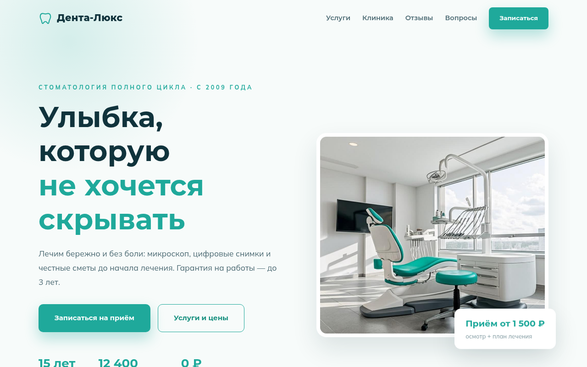
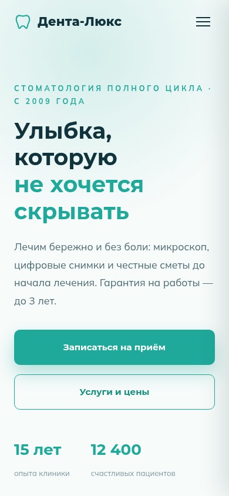

# Дента-Люкс — сайт стоматологии

## Демо

**[Открыть сайт →](https://shalim-andrej.github.io/stomatologiya-denta-lyuks/)**




Одностраничный сайт стоматологической клиники: услуги с ценами, отзывы пациентов, ответы на частые вопросы и форма записи на приём.

**Демо:** [shalim-andrej.github.io/stomatologiya-denta-lyuks](https://shalim-andrej.github.io/stomatologiya-denta-lyuks/)

## О проекте

Концепт-сайт вымышленной клиники «Дента-Люкс» — портфолио-кейс для медицинской ниши, где главное — работа со страхом пациента. Оффер «лечение без боли» и «гарантия 3 года» стоит в заголовке браузера. Дальше сайт последовательно снимает возражения: цены сразу на странице (без «уточняйте по телефону»), реальные отзывы, блок «Вопросы» с ответами врача — и только потом форма записи.

Вёрстка написана с нуля, без конструкторов и фреймворков: чистые HTML, CSS и JavaScript.

## Структура страницы

| Блок | Задача |
|---|---|
| Первый экран | офферы «без боли» и «гарантия 3 года» |
| Услуги | направления лечения с ценами |
| Клиника | оборудование и подход |
| Отзывы | пациенты о лечении |
| Вопросы | FAQ — ответы на частые страхи |
| Записаться | форма на приём |

## Технологии

- **HTML5** — семантическая разметка, строгая иерархия заголовков
- **CSS3** — Flexbox и Grid, адаптив от смартфона до широкого монитора
- **JavaScript (vanilla)** — вся интерактивность без внешних библиотек
- **Форма записи** — заявка на приём без лишних полей
- **SEO-база** — `<title>` с офферами и гарантией, `meta description`

## Запуск локально

```bash
git clone https://github.com/shalim-andrej/stomatologiya-denta-lyuks.git
cd stomatologiya-denta-lyuks
```

Откройте `index.html` в браузере — сборка и зависимости не нужны.

## Автор

Разработчик — Андрей Шалимов ([@shalim-andrej](https://github.com/shalim-andrej)).
Заказать сайт: [Kwork](ССЫЛКА_НА_ПРОФИЛЬ_KWORK)

> Проект демонстрационный: бренд вымышленный, сайт создан как портфолио-кейс.